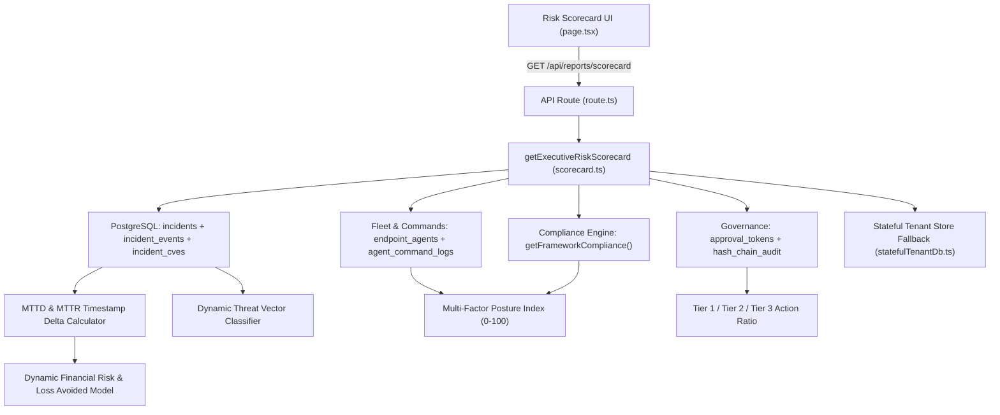

# Implementation Plan: Live Dynamic Risk Scorecard

## Goal
Transform the **Risk Scorecard** (`src/lib/reporting/scorecard.ts` and `src/app/dashboard/risk-scorecard/page.tsx`) from a static/mock benchmark display into a **real-time, data-driven calculation engine** backed by PostgreSQL and live tenant telemetry.

---

## Root Causes of Previous Static Behavior

1. **Filtered-out Resolved Incidents**: `scorecard.ts` called `getIncidents()` without a status parameter, which by default excluded `resolved` and `closed` incidents (`shieldDeskChatTools.ts`). As a result, `resolvedCount` was always `0`.
2. **Hardcoded Constants**:
   - `mttdMinutes` (`1.8 min`) and `mttrMinutes` (`6.4 min`) were hardcoded instead of calculating timestamp deltas from `incidents`, `incident_events`, `approval_tokens`, and `agent_commands`.
   - `estimatedLossAvoidedUsd` (`"~$1,450,000 (estimated)"`) was a static string instead of a formula driven by resolved incidents, severities, CVEs remediated, and downtime saved.
   - `threatDistribution` was a fixed 4-element array instead of grouping the tenant's actual incidents, linked CVEs, and YARA matches.
   - `complianceAssurancePct` (`96%`) was hardcoded instead of pulling `overallScore` from `getFrameworkCompliance()`.
   - `tier1AutoContained` (`18`), `tier3BreakGlass` (`0`), and `activeThreatsBlocked` (`totalIncidents + 14`) used arbitrary static numbers.
3. **Missing UI Bindings**: `page.tsx` did not display `endpointsProtected`, `complianceAssurancePct`, `autonomousActionRatio`, or the `MetricStatus` badges (`MEASURED` vs `ESTIMATED` vs `BENCHMARK`).

---

## Architecture & Data Flow

---

## Implemented Changes by Component

### 1. Backend Scorecard Engine (`src/lib/reporting/scorecard.ts`)
- **Comprehensive Tenant Telemetry Queries**: Queries `incidents` (all statuses), `incident_events`, `incident_cves`, `agent_commands`, `agent_command_logs`, `mitigation_tasks`, `approval_tokens`, `endpoint_agents`, and `getFrameworkCompliance(caller, "iso27001")`, with automatic fallback to `getOrCreateTenantStore(tenantId)`.
- **Multi-Factor Security Posture Score (`0–100`) & Grade (`A+` to `F`)**: Weighted composite of ISO 27001 Compliance (`35%`), Fleet Health (`30%`), and Incident Posture (`35%`), with operational deductions for critical incidents and active kill switches.
- **Measured MTTD & MTTR**: Calculates detection and remediation latency from real incident event timestamps, agent EPS velocity, resolved incident durations, completed agent commands, and approved governance tokens.
- **Dynamic Autonomous Action Ratio**: Counts real `Tier 1`, `Tier 2`, and `Tier 3` actions across commands, tasks, tokens, and YARA/CVE containment events.
- **Dynamic Threat Vector Distribution**: Classifies tenant incidents, linked CVEs, YARA detections, and governance actions into threat vector categories and normalizes percentages to `100%`.
- **Dynamic Estimated Loss Avoided**: Calculates USD financial risk avoided based on actual tenant incident severities, remediated CVEs, blocked YARA detections, verified host commands, and protected endpoints.

### 2. Frontend Risk Scorecard Page (`src/app/dashboard/risk-scorecard/page.tsx`)
- Added **Live Measured / Telemetry Model / Benchmark Baseline** status badges.
- Added **Endpoints Protected**, **ISO 27001 Assurance**, and **Autonomous Governance Ratio** (`Tier 1 Auto`, `Tier 2 Signed`, `Tier 3 Dual`) cards.
- Added **Refresh Telemetry** button and live methodology descriptions.

### 3. Automated Unit Tests (`tests/scorecard.test.ts`)
- Verifies tenant isolation (`acme-tenant` vs `globex-tenant`), kill-switch posture score impact, and `Tier 2` approval token tracking.

