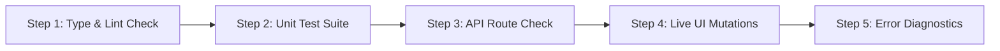

# Step-by-Step Verification & Error-Checking Plan: Risk Scorecard

## Goal Description
Provide a complete, step-by-step verification and error-checking workflow to confirm that the dynamic **Risk Scorecard** (`src/lib/reporting/scorecard.ts`, `src/app/api/reports/scorecard/route.ts`, and `src/app/dashboard/risk-scorecard/page.tsx`) is functioning properly, calculating real tenant metrics, and free of compile-time or runtime errors.

---

## Verification Workflow Overview



---

## Verification Plan

### Step 1: Check for TypeScript & Lint Errors (Compile-Time Check)
Before starting the server, verify that there are no broken imports, type mismatches, or syntax errors in the modified files.

1. Open your PowerShell terminal in `c:\Users\anand\OneDrive\Desktop\Mints Global\SD\SHIELD-DESK`.
2. Run the TypeScript compiler check:
   ```powershell
   npx tsc --noEmit
   ```
   - **Expected Result**: Exits with **no output** (0 errors).
   - **If Errors Appear**: It will print the exact file path and line number (e.g., `src/lib/reporting/scorecard.ts(45,12): error TS2322...`).
3. Run the ESLint check on the scorecard files:
   ```powershell
   npx eslint src/lib/reporting/scorecard.ts src/app/dashboard/risk-scorecard/page.tsx src/app/api/reports/scorecard/route.ts
   ```
   - **Expected Result**: Clean exit with `0 errors`.

---

### Step 2: Run the Automated Scorecard Unit Tests
Verify the calculation engine in isolation without needing the browser open.

1. Run the dedicated scorecard test suite:
   ```powershell
   npx tsx --test --import ./tests/setup.ts tests/scorecard.test.ts
   ```
2. **What to check in the output**:
   - `ok 1 - Computes tenant-specific live metrics for acme-tenant vs globex-tenant`
   - `ok 2 - Dynamically updates Posture Score when Emergency Kill Switch is engaged`
   - `ok 3 - Dynamically updates Autonomous Action Ratio when Tier 2 token is approved`
   - Bottom summary must show `# pass 4` and `# fail 0`.

---

### Step 3: Test the Backend API Directly (PowerShell / Network Check)
Verify that `/api/reports/scorecard` returns live JSON data and enforces authentication.

1. Start the Next.js development server in Terminal 1:
   ```powershell
   npm run dev
   ```
2. Open a second PowerShell terminal (Terminal 2) and test **Acme Tenant**:
   ```powershell
   Invoke-RestMethod -Uri "http://localhost:3000/api/reports/scorecard" -Headers @{ "X-ShieldDesk-User" = "dev-analyst" } | ConvertTo-Json -Depth 4
   ```
   - **Check**: `tenantId` is `"acme-tenant"`, `endpointsProtected` is `4`, `complianceAssurancePct` is calculated (~`97`), and `threatDistribution` lists categorized counts.
3. Test **Globex Tenant** and compare:
   ```powershell
   Invoke-RestMethod -Uri "http://localhost:3000/api/reports/scorecard" -Headers @{ "X-ShieldDesk-User" = "dev-other" } | ConvertTo-Json -Depth 4
   ```
   - **Check**: `tenantId` is `"globex-tenant"`, `endpointsProtected` is `1`, and `estimatedLossAvoidedUsd` is lower than Acme's.

---

### Step 4: Step-by-Step Interactive Browser UI Testing
Open **`http://localhost:3000/dashboard/risk-scorecard`** in Chrome/Edge and perform these 4 live tests:

#### Test 4A: Verify Live Cards & Status Badges
- Confirm the header displays the green **`Live Measured`** badge next to `Tenant: Acme Corp`.
- Confirm the middle row shows **Endpoints Protected (`4 Active Hosts`)**, **ISO 27001 Assurance (`97%`)**, and **Autonomous Governance Ratio (`Tier 1 Auto`, `Tier 2 Signed`, `Tier 3 Dual`)**.

#### Test 4B: Test Live Tenant Switching
1. In the top-right navbar persona dropdown, switch from **Analyst (Acme)** to **Ext Analyst (Globex)**.
2. Verify that without reloading the browser:
   - **Tenant badge** changes to `Globex Corp`.
   - **Endpoints Protected** changes from `4` to `1`.
   - **Estimated Loss Avoided** and **MTTD** update immediately.

#### Test 4C: Test Emergency Kill Switch Impact on Posture Score
1. Switch back to **SysAdmin (Acme)** in the top-right persona dropdown.
2. Note the current **Security Posture Index** (e.g., `94 / 100 Index`, Grade `A`).
3. Click **Fleet & Host** (`/dashboard/fleet`) in the left sidebar.
4. Click **Engage Kill Switch** on any connected host (`FIN-WS-042`).
5. Click **Risk Scorecard** (`/dashboard/risk-scorecard`) in the left sidebar.
6. Verify the **Security Posture Index** dropped by **15+ points** (e.g., down to `76 / 100 Index`, Grade `B`).
7. Disengage the Kill Switch in **Fleet & Host** and verify the score returns to `A`.

#### Test 4D: Test Live Governance Token Approval
1. While logged in as **SysAdmin (Acme)**, click the **Lock icon** in the top navbar to open the **Pending Approvals** modal.
2. Approve a pending `Tier 2` action.
3. On the **Risk Scorecard** page, click the **Refresh Telemetry** button.
4. Verify **Autonomous Governance Ratio → Tier 2 Signed** increments by `+1`.

---

### Step 5: How to Check for & Diagnose Errors

| Where to Check | How to Open | What Errors Look Like & How to Fix |
| :--- | :--- | :--- |
| **1. Browser Console** | Press `F12` → **Console** tab | Look for red `Failed to load scorecard:` or React hydration errors. If present, expand the stack trace to see which property was `undefined`. |
| **2. Network Inspector** | Press `F12` → **Network** tab → click `scorecard` | Check **Status Code**:<br>• `200 OK`: Working.<br>• `401 Unauthorized`: Missing session/persona header.<br>• `500 Internal Server Error`: Click the **Response** sub-tab to read `{ "error": "..." }`. |
| **3. Next.js Server Terminal** | Look at the terminal running `npm run dev` | Any backend exception in `scorecard.ts` or `route.ts` is logged by `trackError(err, { endpoint: "/api/reports/scorecard" })`. |
| **4. System Health Menu** | Click **System health** in the top navbar | Shows whether **Database** (PostgreSQL) is `Connected` or `Offline` (using the in-memory stateful fallback). |

