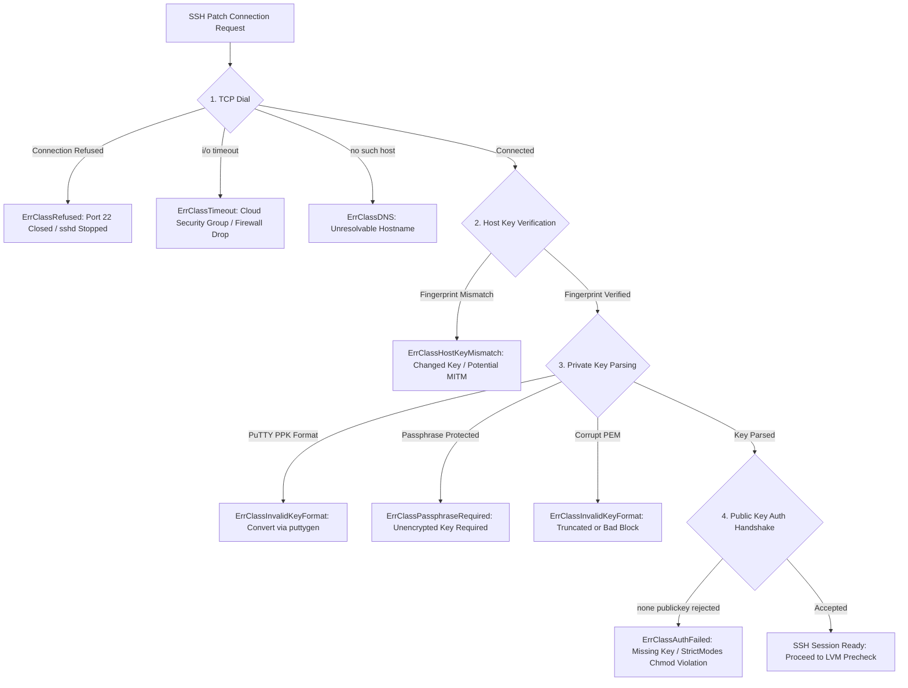

# ShieldDesk™ — Linux SSH Connectivity & Public Key Authentication Troubleshooting Runbook

**Document Version:** 1.0.0  
**Date:** October 2026  
**Audience:** SOC Operators, Platform Engineers, System Administrators  
**Target Subsystems:** ShieldDesk SSH Patch Orchestrator, Linux Target Daemons (`sshd`), Web Console Pre-Flight Probe  
**Security Standard:** Strict Zero-Mock Host Verification (Rule 3: **PROVE BEFORE YOU ACT**)  

---

## 1. Overview & Architecture

When deploying security patches across enterprise Linux fleets via the ShieldDesk SSH Patch Orchestrator or the Web Console (`/dashboard/scanner#patch`), secure communications rely on strict OpenSSH standards:
1. **Pinned Host Key Verification:** The orchestrator never blindly accepts host keys (`InsecureIgnoreHostKey` is strictly forbidden). Every connection verifies the remote host's public key against the configured SHA-256 fingerprint.
2. **Public Key Authentication Only:** Password authentication is disabled for automated patching pipelines. All connections require a valid RSA, ECDSA, or Ed25519 private key.
3. **Fail-Closed Diagnostics:** Any failure in the TCP handshake, host key verification, or cryptographic authentication halts the pipeline immediately and surfaces structured diagnostic hints and copyable bash remedies.



---

## 2. Network Reachability & Dial Failures

### 2.1 Connection Refused (`ErrClassRefused`)
**Observed Error:**
```text
dial tcp <target-ip>:22: connectex: No connection could be made because the target machine actively refused it.
```
**Underlying Cause:**
- The `sshd` daemon is not active on the target host.
- The daemon is listening on a non-standard port (e.g., 2222 or 22022) instead of port 22.
- An intermediate proxy or load balancer terminated the connection.

**Actionable Linux Remediation:**
```bash
# 1. Check if OpenSSH daemon is running:
sudo systemctl status ssh     # Ubuntu / Debian
sudo systemctl status sshd    # RHEL / CentOS / Rocky Linux

# 2. Start and enable sshd if stopped:
sudo systemctl start ssh && sudo systemctl enable ssh

# 3. Verify listening ports and socket bindings:
sudo ss -tulpn | grep -E 'sshd|ssh'

# 4. If listening on a custom port, update the Port field in ShieldDesk and /etc/ssh/sshd_config:
grep -i "^Port" /etc/ssh/sshd_config
```

---

### 2.2 Connection Timeout (`ErrClassTimeout`)
**Observed Error:**
```text
connection timed out during dial (i/o timeout)
```
**Underlying Cause:**
- SYN packets are silently dropped by a cloud firewall, VPC Security Group, or host firewall (`ufw`, `iptables`, `nftables`).

**Actionable Linux Remediation:**
```bash
# 1. Cloud Provider Security Groups:
# AWS / GCP / Azure: Verify Inbound Security Group rule permits TCP port 22 from the orchestrator IP.

# 2. Target Linux Host Firewall (UFW - Ubuntu/Debian):
sudo ufw status verbose
sudo ufw allow 22/tcp

# 3. Target Linux Host Firewall (Firewalld - RHEL/Rocky):
sudo firewall-cmd --list-all
sudo firewall-cmd --permanent --add-service=ssh
sudo firewall-cmd --reload

# 4. Check iptables drop rules:
sudo iptables -L -n -v | grep -E 'dpt:22|DROP'
```

---

### 2.3 DNS Resolution Failure (`ErrClassDNS`)
**Observed Error:**
```text
DNS resolution failed: lookup <hostname>: no such host
```
**Underlying Cause:**
- Internal DNS record has not propagated, hostname typo, or unreachable resolver in `/etc/resolv.conf`.

**Actionable Linux Remediation:**
```bash
# 1. Test name resolution:
getent hosts srv-target-01.corp.internal

# 2. Check resolver configuration:
cat /etc/resolv.conf

# 3. Alternative: Use static IPv4 address in ShieldDesk patch configuration.
```

---

## 3. Host Key Verification & Pinned Fingerprints

### 3.1 Host Key Fingerprint Mismatch (`ErrClassHostKeyMismatch`)
**Observed Error:**
```text
host key fingerprint mismatch (expected: SHA256:..., received: SHA256:...)
```
**Underlying Cause:**
- ShieldDesk enforces strict host key verification. This error triggers when:
  1. The server OS was re-provisioned or OpenSSH host keys regenerated.
  2. The hostname resolves to a different server or IP address.
  3. A Man-in-the-Middle (MITM) proxy is intercepting SSH traffic.

**Actionable Linux Remediation:**
```bash
# Query the genuine SHA-256 host key fingerprint from an authoritative bastion host:
ssh-keyscan -p <port> <target-ip> 2>/dev/null | ssh-keygen -lf -

# Example Output:
# 256 SHA256:d8a2b3c4e5f6a7b8c9d0e1f2a3b4c5d6e7f8a9b0c1d2e3f4a5b6c7d8e9f0a1b2 10.0.0.5 (ED25519)

# Action: Copy the "SHA256:..." hash and update HostKeyFingerprint in the ShieldDesk patch configuration.
```

---

## 4. Private Key Format & Parsing Failures

### 4.1 PuTTY Format Detected (`ErrClassInvalidKeyFormat`)
**Observed Error:**
```text
PuTTY key format (.ppk) detected; OpenSSH PEM format is required
```
**Underlying Cause:**
- The operator pasted a PuTTY `.ppk` private key (`PuTTY-User-Key-File-2`). Go's crypto SSH engine and standard Linux OpenSSH servers only accept OpenSSH PEM blocks.

**Actionable Remediation:**
```bash
# Windows (via PuTTYgen CLI):
puttygen id_key.ppk -O private-openssh -o id_rsa

# Linux (via putty-tools):
sudo apt install -y putty-tools
puttygen id_key.ppk -O private-openssh -o id_rsa

# Action: Open the exported 'id_rsa' file in a text editor and paste the OpenSSH PEM into ShieldDesk.
```

---

### 4.2 Passphrase-Protected Key (`ErrClassPassphraseRequired`)
**Observed Error:**
```text
private key is passphrase-protected
```
**Underlying Cause:**
- The private key is encrypted with AES/DES/PKCS#8 (`Proc-Type: 4,ENCRYPTED`). ShieldDesk's automated orchestrator operates unattended and cannot interactively prompt for a passphrase during emergency CVE patch rollouts.

**Actionable Remediation:**
```bash
# Option A: Decrypt the existing key to an unattended deployment copy:
openssl rsa -in id_rsa -out id_rsa_unencrypted
chmod 600 id_rsa_unencrypted

# Option B: Generate a dedicated, unencrypted Ed25519 deployment key for ShieldDesk:
ssh-keygen -t ed25519 -N "" -C "shielddesk-orchestrator@enterprise" -f ./shielddesk_deploy_key

# Enroll the public key onto the target fleet host:
ssh-copy-id -i ./shielddesk_deploy_key.pub ubuntu@<target-host>
```

---

## 5. Public Key Authentication & StrictModes Failures

### 5.1 Public Key Rejected (`ErrClassAuthFailed`)
**Observed Error:**
```text
ssh: unable to authenticate, attempted methods [none publickey], no supported methods remain
```
**Underlying Cause:**
1. **OpenSSH `StrictModes` Violation:** OpenSSH silently ignores `~/.ssh/authorized_keys` if the file or parent directory has overly permissive permissions (e.g., `chmod 777` or writeable by `group`/`others`).
2. **Missing Public Key:** The corresponding public key has not been added to the target user's `~/.ssh/authorized_keys`.
3. **Wrong Target Username:** Attempting to log in as `ubuntu` on an Amazon Linux host (where default user is `ec2-user`), or `root` when `PermitRootLogin` is disabled.
4. **Disabled Pubkey Authentication:** `PubkeyAuthentication no` in `/etc/ssh/sshd_config`.

**Actionable Linux Host Remediation (Run on Target Server):**
```bash
# Step 1: Enforce strict OpenSSH directory and file permissions:
chmod 700 ~/.ssh
chmod 600 ~/.ssh/authorized_keys

# Step 2: Ensure correct ownership:
chown -R $USER:$USER ~/.ssh

# Step 3: Append your public key to authorized_keys:
echo "ssh-ed25519 AAAAC3NzaC1lZDI1NTE5AAAAI... shielddesk-orchestrator" >> ~/.ssh/authorized_keys

# Step 4: Verify sshd_config settings:
sudo grep -E "^(PubkeyAuthentication|StrictModes|AuthorizedKeysFile)" /etc/ssh/sshd_config

# If PubkeyAuthentication is 'no', change to 'yes' and reload:
sudo sed -i 's/^PubkeyAuthentication no/PubkeyAuthentication yes/' /etc/ssh/sshd_config
sudo systemctl reload ssh || sudo systemctl reload sshd

# Step 5: Live debug authentication rejections on target:
# On Ubuntu/Debian:
sudo tail -f /var/log/auth.log

# On RHEL/CentOS/Rocky:
sudo journalctl -u sshd -f
```

---

## 6. Web Console Pre-Flight Test Probe

To prevent failed patching jobs, operators can validate connectivity and keys prior to initiating LVM snapshots:
1. Open **Security Scanner** -> **SSH Patching** (`/dashboard/scanner#patch`).
2. Enter the target host, user, port, fingerprint, and PEM key.
3. If an invalid or PuTTY key is pasted, an **instant inline warning** appears with conversion instructions.
4. Click **"Test Connection"**:
   - The orchestrator executes a lightweight pre-flight probe (`POST /api/patch/test`).
   - If authentication succeeds, a green badge `[PROBE SUCCESS]` appears.
   - If authentication fails, the exact error class, root cause, and copyable bash remedies stream into the terminal log.

---

## 7. Checklist for Production Fleet Onboarding

| Step | Verification Check | Command |
| :---: | :--- | :--- |
| **1** | OpenSSH daemon listening on port 22 | `sudo ss -tulpn \| grep ssh` |
| **2** | Inbound TCP/22 allowed through firewalls | `sudo ufw status` / AWS Security Group rules |
| **3** | Host key fingerprint verified | `ssh-keyscan -p 22 <ip> 2>/dev/null \| ssh-keygen -lf -` |
| **4** | Dedicated unencrypted deployment key generated | `ssh-keygen -t ed25519 -N ""` |
| **5** | Target permissions enforce StrictModes | `chmod 700 ~/.ssh && chmod 600 ~/.ssh/authorized_keys` |
| **6** | Pre-flight probe verified in Web Console | Click **Test Connection** in `/dashboard/scanner#patch` |
