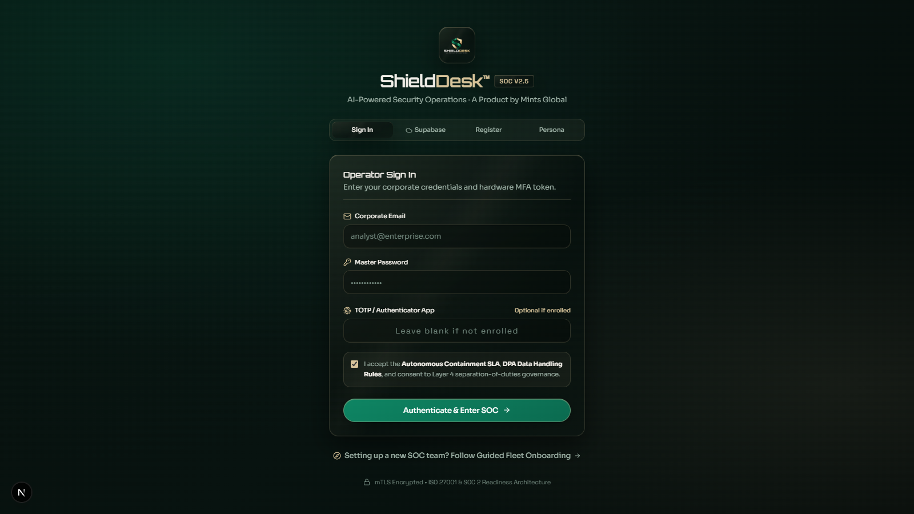
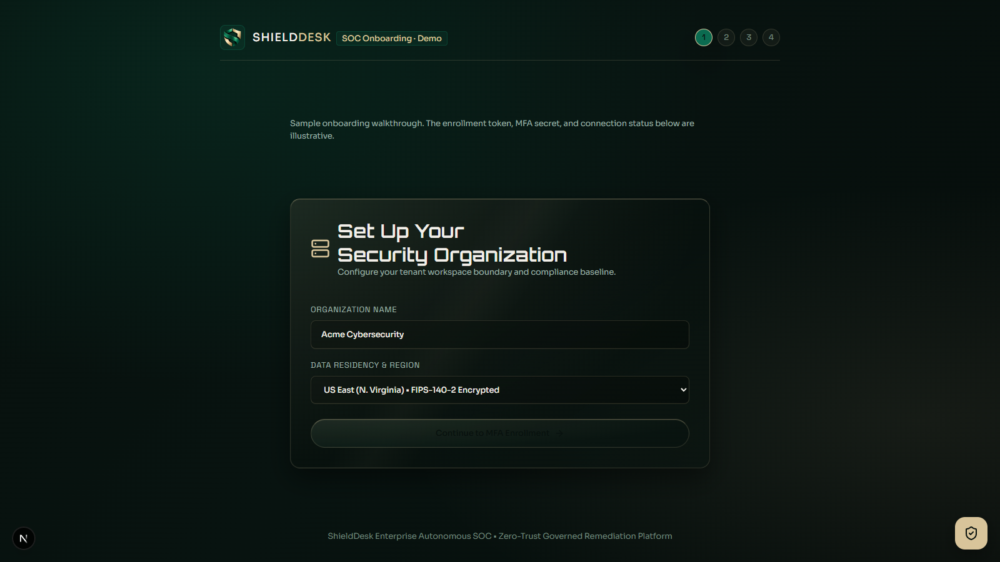
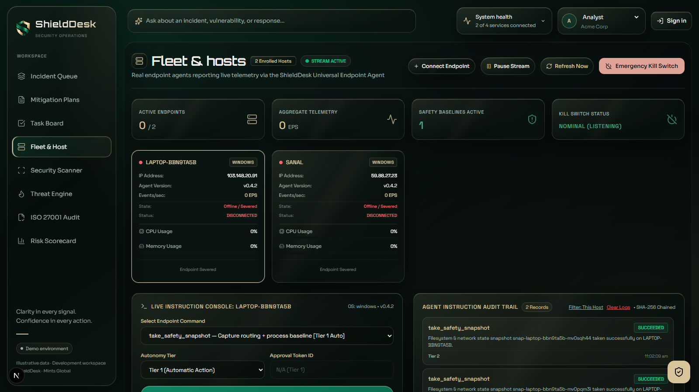
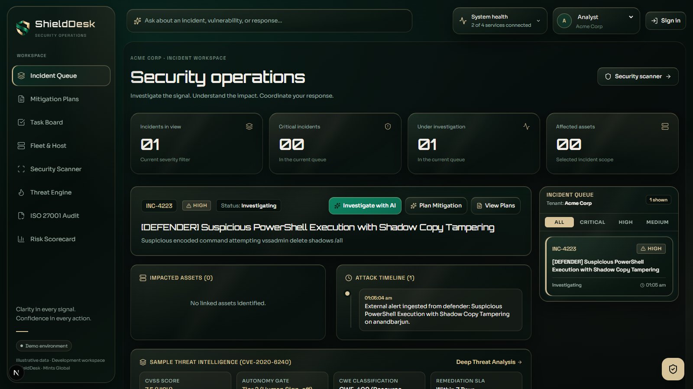
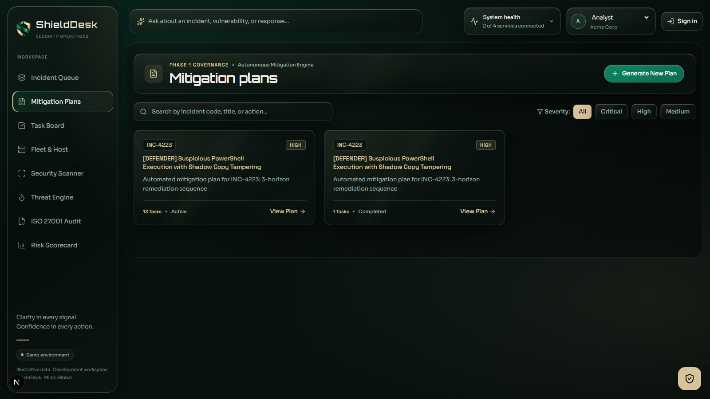
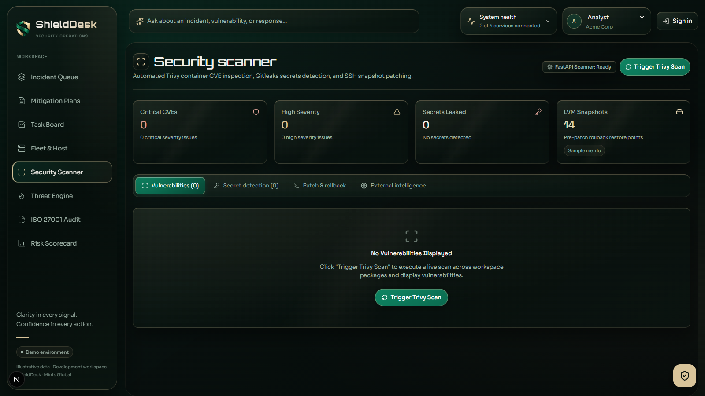
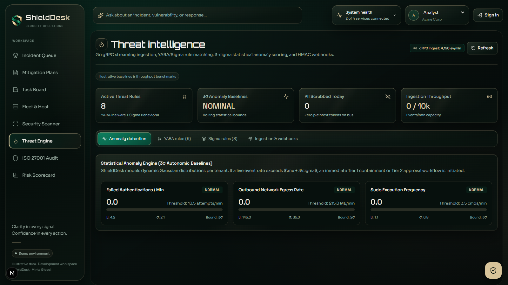
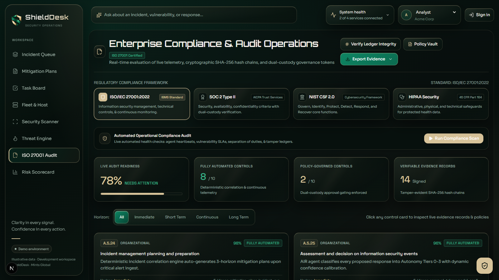
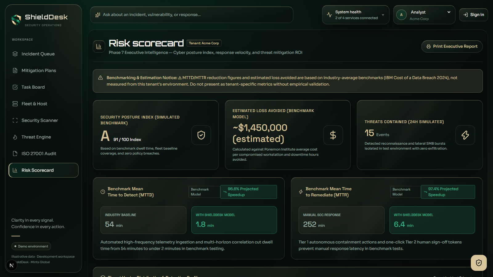

# ShieldDesk™ Customer User Guide
### Evidence-Driven Autonomous SOC, Endpoint PKI & Zero-Trust Remediation

> **Version:** 2.4 Enterprise Edition  
> **Target Audience:** Security Operations Engineers (SecOps), SOC Analysts, Incident Responders, CISOs, Compliance Officers & Platform Administrators  
> **Publisher:** Mints Global Security Engineering  
> **Core Principle:** **PROVE BEFORE YOU ACT**

---

## Table of Contents

1. [Platform Overview & Architecture](#1-platform-overview--architecture)
   - [What is ShieldDesk?](#what-is-shielddesk)
   - [The "Prove Before You Act" Paradigm](#the-prove-before-you-act-paradigm)
   - [Multi-Tenant Cryptographic Isolation](#multi-tenant-cryptographic-isolation)
2. [Getting Started & First-Time Onboarding](#2-getting-started--first-time-onboarding)
   - [Signing In & Enterprise Authentication](#signing-in--enterprise-authentication)
   - [The 4-Step Interactive Onboarding Wizard](#the-4-step-interactive-onboarding-wizard)
   - [Managing API Keys & Organization Settings](#managing-api-keys--organization-settings)
3. [Fleet Management & Endpoint Agent Deployment](#3-fleet-management--endpoint-agent-deployment)
   - [Endpoint Agent Architecture (Go Universal Daemon)](#endpoint-agent-architecture-go-universal-daemon)
   - [Windows Deployment (PowerShell)](#windows-deployment-powershell)
   - [Linux & macOS Deployment (Bash / Systemd)](#linux--macos-deployment-bash--systemd)
   - [mTLS X.509 PKI Handshake & Health Telemetry](#mtls-x509-pki-handshake--health-telemetry)
   - [Issuing Signed Remote Host Commands](#issuing-signed-remote-host-commands)
   - [Emergency Fleet Kill Switch](#emergency-fleet-kill-switch)
4. [Security Operations & Incident Triage (SOC Workspace)](#4-security-operations--incident-triage-soc-workspace)
   - [Navigating the Incident Queue (`/`)](#navigating-the-incident-queue-)
   - [Severity Classification & Response SLAs](#severity-classification--response-slas)
   - [Deep Incident Investigation](#deep-incident-investigation)
   - [Attack Timeline & Kill-Chain Correlation](#attack-timeline--kill-chain-correlation)
   - [AI SOC Co-Pilot & Blast Radius Simulation](#ai-soc-co-pilot--blast-radius-simulation)
5. [3-Horizon Remediation Planning & Task Board](#5-3-horizon-remediation-planning--task-board)
   - [The 3-Horizon Strategy Explained (H1, H2, H3)](#the-3-horizon-strategy-explained-h1-h2-h3)
   - [Generating & Customizing Mitigation Plans (`/dashboard/plans`)](#generating--customizing-mitigation-plans-dashboardplans)
   - [Executing Action Items on the Task Board (`/dashboard/tasks`)](#executing-action-items-on-the-task-board-dashboardtasks)
6. [Governance, Autonomy Tiers & Dual-Custody Approvals](#6-governance-autonomy-tiers--dual-custody-approvals)
   - [The 4-Tier Autonomy Gate Matrix](#the-4-tier-autonomy-gate-matrix)
   - [Role-Based Access Control (RBAC) Permissions](#role-based-access-control-rbac-permissions)
   - [Separation of Duties & SuperAdmin Dual-Custody](#separation-of-duties--superadmin-dual-custody)
   - [Reviewing & Authorizing Actions in the Approvals Center](#reviewing--authorizing-actions-in-the-approvals-center)
7. [Vulnerability & Secret Scanner Console](#7-vulnerability--secret-scanner-console)
   - [Aqua Security Trivy Deep Vulnerability Scans](#aqua-security-trivy-deep-vulnerability-scans)
   - [Gitleaks High-Entropy Secret & Key Detection](#gitleaks-high-entropy-secret--key-detection)
   - [External Threat Intelligence: Shodan & Have I Been Pwned](#external-threat-intelligence-shodan--have-i-been-pwned)
   - [Remediating Findings Directly from the Scanner](#remediating-findings-directly-from-the-scanner)
8. [Threat Intelligence & Detection Engines](#8-threat-intelligence--detection-engines)
   - [3-Sigma Gaussian Statistical Anomaly Detection](#3-sigma-gaussian-statistical-anomaly-detection)
   - [Native YARA Malware Threat Engine (Compiler & Sandbox)](#native-yara-malware-threat-engine-compiler--sandbox)
   - [Sigma Behavioral Detection Rules](#sigma-behavioral-detection-rules)
   - [Real-Time Alert Feed & HMAC Webhook Dispatch](#real-time-alert-feed--hmac-webhook-dispatch)
9. [Continuous Compliance Matrix & Tamper-Evident Ledger](#9-continuous-compliance-matrix--tamper-evident-ledger)
   - [Supported Regulatory Frameworks (SOC 2, ISO 27001, NIST, HIPAA, PCI-DSS)](#supported-regulatory-frameworks-soc-2-iso-27001-nist-hipaa-pci-dss)
   - [Evidence Collection & Policy Vault](#evidence-collection--policy-vault)
   - [SHA-256 Merkle Hash-Chain Cryptographic Verifier](#sha-256-merkle-hash-chain-cryptographic-verifier)
   - [Exporting Auditor-Ready Packages](#exporting-auditor-ready-packages)
10. [Executive Risk Scorecard & Posture Index](#10-executive-risk-scorecard--posture-index)
    - [Understanding the Cyber Posture Index (0–100)](#understanding-the-cyber-posture-index-0100)
    - [Financial Loss Avoided & MTTD/MTTR Velocity](#financial-loss-avoided--mttdmttr-velocity)
    - [Switching Operator Personas (Executive, SecOps, Auditor)](#switching-operator-personas-executive-secops-auditor)
11. [Commercial Subscriptions, Billing & Quota Management](#11-commercial-subscriptions-billing--quota-management)
    - [Subscription Tiers (Community, Professional, Enterprise)](#subscription-tiers-community-professional-enterprise)
    - [Upgrading & Stripe / Razorpay Checkout](#upgrading--stripe--razorpay-checkout)
    - [Managing Endpoint Seats & Invoices](#managing-endpoint-seats--invoices)
12. [Account Security, MFA & Session Hygiene](#12-account-security-mfa--session-hygiene)
    - [Hardware TOTP MFA Configuration](#hardware-totp-mfa-configuration)
    - [Cryptographic Session Cookies & Timeouts](#cryptographic-session-cookies--timeouts)
13. [Troubleshooting, Diagnostics & FAQ](#13-troubleshooting-diagnostics--faq)
14. [Customer Support & Escalation Procedures](#14-customer-support--escalation-procedures)

---

## 1. Platform Overview & Architecture

### What is ShieldDesk?

**ShieldDesk™** is an enterprise-grade autonomous Security Operations Center (SOC) platform, endpoint Public Key Infrastructure (PKI) control plane, and zero-trust remediation orchestrator. It unifies threat detection, alert correlation, AI-assisted blast-radius investigation, endpoint fleet containment, and continuous regulatory compliance into a single, high-performance web console.

ShieldDesk serves as your 24/7 digital SOC co-pilot:
- **Ingests & Correlates**: Ingests high-throughput telemetry from CrowdStrike Falcon, Microsoft Defender, Wazuh, Syslog, and custom webhooks.
- **Normalizes & Redacts**: Automatically scrubs API keys, private keys, database passwords, and Personally Identifiable Information (PII) before storage.
- **Investigates with AI**: Employs private, local AI models (Ollama or enterprise LLMs) to analyze attack vectors, compute Exploit Prediction Scoring System (EPSS) probabilities, and model blast radii without leaking proprietary data.
- **Governs with Rigor**: Enforces multi-tier human approvals, dual-custody separation of duties, and hardware TOTP MFA before executing containment.
- **Executes Cryptographically**: Dispatches cryptographically signed (`RSA-SHA256`) commands to universal endpoint agents with automatic rollback protection.
- **Proves Compliance**: Maintains a tamper-evident SHA-256 Merkle hash-chain ledger mapped to SOC 2 Type II, ISO 27001:2022, NIST CSF 2.0, HIPAA, and PCI-DSS v4.0.

### The "Prove Before You Act" Paradigm

Conventional security tools either blast alert noise without action or take rash automated actions that break business continuity. ShieldDesk operates on the foundational invariant: **PROVE BEFORE YOU ACT**.

```
[ Ingest Telemetry ]
        │
        ▼
[ Secret Redaction & Normalization ]
        │
        ▼
[ Cryptographic Evidence Verification ] ──▶ (Invalid/Unverified? Flagged for Manual Review)
        │
        ▼
[ Blast-Radius & Dependency Simulation ]
        │
        ▼
[ 4-Tier Autonomy Gate & Dual-Custody MFA ]
        │
        ▼
[ RSA-Signed Command Dispatch with Pre-flight Snapshot & Auto-Rollback ]
        │
        ▼
[ Merkle Hash-Chain Tamper-Evident Audit Ledger ]
```

Every containment or remediation command requires:
1. **Observable Physical Evidence**: Verified telemetry or process match before triggering response playbooks.
2. **Deterministic Blast Radius Calculation**: Evaluating which upstream and downstream dependencies are affected before isolating a system.
3. **Safety Snapshots**: Pre-execution system state capture allowing one-click rollback if service interruption occurs.
4. **Appropriate Human Governance**: Strict separation of duties ensuring no single operator can execute catastrophic actions without peer sign-off.

### Multi-Tenant Cryptographic Isolation

ShieldDesk is built from the ground up for strict multi-tenancy:
- **Data Segregation**: All database records, telemetry events, threat alerts, YARA matches, scans, and remediation plans are cryptographically tagged with a unique `tenant_id`.
- **Query Scoping**: Every internal API and SQL query enforces `WHERE tenant_id = $callerTenant`. Even if an attacker guesses an incident ID or agent ID from another organization, the request returns a strict `404 Not Found` or `403 Forbidden`.
- **Scan Cache Partitioning**: In-memory and cache stores for vulnerability scans (Trivy) and secret scans (Gitleaks) are isolated per tenant ID.
- **Dedicated Keys & Webhook Secrets**: Each organization maintains distinct HMAC webhook signing secrets and PKI enrollment tokens.

---

## 2. Getting Started & First-Time Onboarding

### Signing In & Enterprise Authentication

Navigate to your organization's ShieldDesk deployment (e.g., `https://control.shielddesk.io` or your custom enterprise subdomain).



1. **Email & Password**: Enter your corporate email and password. All passwords are authenticated using `scrypt` memory-hard hashing.
2. **SSO / Identity Provider**: For organizations configured with Okta, Google Workspace, or Azure Active Directory, select your corporate SSO provider.
3. **Time-Based One-Time Password (TOTP)**: If MFA is configured on your account, enter the 6-digit code from your authenticator app (Google Authenticator, Microsoft Authenticator, 1Password, or YubiKey).

> [!NOTE]
> Sessions are maintained in secure, `HttpOnly`, `SameSite=Lax`, cryptographically signed cookies (`shielddesk_session`). Sessions automatically expire after 8 hours of inactivity.

---

### The 4-Step Interactive Onboarding Wizard

If you are setting up a new organization or initiating a commercial pilot, ShieldDesk provides a guided onboarding experience at `/onboarding`.



#### Step 1: Organization & Primary Baseline
- **Organization Name**: Your company or business unit name (generates a unique `tenant_id`).
- **Primary Compliance Standard**: Select your initial regulatory focus (e.g., *SOC 2 Type II*, *ISO 27001:2022*, *NIST CSF 2.0*, *HIPAA*, or *PCI-DSS v4.0*). This pre-populates your continuous compliance matrices and control vaults.
- **Designated Security Contact**: The primary email for security escalations and high-severity incident notifications.

#### Step 2: Endpoint Fleet Enrollment
- The wizard generates a tenant-scoped **Enrollment Token** and ready-to-run installation commands for both Windows and Linux/macOS.
- Run the command on at least one server or workstation to establish the initial mTLS connection to the control plane.
- The wizard displays a real-time listening animation and automatically marks this step complete once the first agent sends a valid cryptographic heartbeat.

#### Step 3: Hardware MFA / TOTP Activation
- Displays an RFC 6238-compliant QR code and secret key.
- Scan the QR code using your authenticator application.
- Enter the generated 6-digit verification code to confirm synchronization and activate mandatory dual-custody privileges.

#### Step 4: Launch SOC Control Center
- Confirms tenant initialization, seeds standard YARA and Sigma rulesets, activates the 3-Sigma anomaly baseline, and redirects you directly to the **Incident Operations Workspace**.

---

### Managing API Keys & Organization Settings

Administrators can access API and integration tokens via the platform header:
- **Agent Enrollment Token**: Used exclusively to register new endpoint hosts into your organization's fleet.
- **Ingestion Webhook Secret**: Used to authenticate inbound syslog, CrowdStrike, and Wazuh alerts via `X-ShieldDesk-Signature` HMAC-SHA256 headers.
- **REST API Keys**: Bearer tokens used for automated CI/CD scans, external SOAR integrations, and GRC exports.

---

## 3. Fleet Management & Endpoint Agent Deployment

The **Fleet Management Console** (`/dashboard/fleet`) provides complete visibility and command orchestration across your server and workstation infrastructure.



### Endpoint Agent Architecture (Go Universal Daemon)

The ShieldDesk Universal Endpoint Agent is a lightweight, low-footprint daemon written in Go:
- **Resource Footprint**: < 25 MB RAM and < 1% CPU utilization during continuous monitoring.
- **Cryptographic Identity**: Generates a local 2048-bit RSA keypair during installation; certificate signing request (CSR) is verified by the ShieldDesk Control Plane PKI.
- **Communication Protocol**: Secure bidirectional mTLS v1.3 with heartbeats sent every 30 seconds.
- **Offline Resiliency**: In the event of network disruption, telemetry events and tamper logs are buffered locally in an encrypted ring buffer and flushed upon reconnection.

---

### Windows Deployment (PowerShell)

To deploy the agent on Windows Server (2016, 2019, 2022) or Windows 10/11 Enterprise:

1. Open PowerShell as **Administrator**.
2. Run the one-line deployment script:

```powershell
Set-ExecutionPolicy Bypass -Scope Process -Force; `
[System.Net.ServicePointManager]::SecurityProtocol = [System.Net.SecurityProtocolType]::Tls12; `
Invoke-WebRequest -Uri "https://control.shielddesk.io/install-windows.ps1" -OutFile "$env:TEMP\shielddesk-install.ps1"; `
& "$env:TEMP\shielddesk-install.ps1" `
  -ControlPlaneUrl "https://control.shielddesk.io" `
  -EnrollToken "YOUR_TENANT_ENROLLMENT_TOKEN"
```

The installer:
- Installs the binary to `C:\Program Files\ShieldDesk\shielddesk-agent.exe`.
- Creates and starts a resilient Windows Service (`ShieldDeskAgent`) set to Automatic startup.
- Establishes host PKI certificates in `C:\ProgramData\ShieldDesk\pki\`.
- Transmits initial hardware telemetry (hostname, CPU, RAM, OS build, active network interfaces).

---

### Linux & macOS Deployment (Bash / Systemd)

To deploy on Ubuntu, Debian, RHEL, CentOS, Rocky Linux, or Amazon Linux:

1. Open a terminal with root/sudo privileges.
2. Run the universal installer command:

```bash
curl -sSL https://control.shielddesk.io/install.sh | sudo bash -s -- \
  --control-plane "https://control.shielddesk.io" \
  --token "YOUR_TENANT_ENROLLMENT_TOKEN"
```

The installer:
- Installs the binary to `/usr/local/bin/shielddesk-agent`.
- Configures a `systemd` unit file at `/etc/systemd/system/shielddesk-agent.service`.
- Generates mTLS host credentials in `/etc/shielddesk/pki/`.
- Enables and starts the service: `systemctl enable --now shielddesk-agent`.

---

### mTLS X.509 PKI Handshake & Health Telemetry

Once enrolled, each endpoint appears in the **Fleet Management** grid:

| Host Property | Description |
| :--- | :--- |
| **Hostname & IP** | Primary network identity, internal IP, and public egress IP. |
| **Platform** | OS distribution and kernel/build version (e.g., `Ubuntu 22.04 LTS`, `Windows Server 2022`). |
| **Status Badge** | `ONLINE` (green), `OFFLINE` (grey), `DEGRADED` (amber), `COMPROMISED` (red), or `ISOLATED` (purple). |
| **Telemetry Meters** | Live CPU and RAM consumption updated via continuous telemetry. |
| **Certificate Expiry** | Displays X.509 client certificate lifespan; auto-rotated 30 days prior to expiration. |

---

### Issuing Signed Remote Host Commands

ShieldDesk allows authorized operators to dispatch remediation and diagnostic actions directly to agents. Click any host card to open the **Command Execution Drawer**:

1. **Select Action**:
   - `take_safety_snapshot`: Captures current running processes, open network sockets, and critical registry/system config before any modifications.
   - `isolate_host`: Disconnects all network interfaces except for the encrypted mTLS connection to the ShieldDesk control plane (prevents lateral movement).
   - `restore_network`: Re-enables all physical and virtual network adapters.
   - `kill_process`: Terminates a malicious PID identified in triage.
   - `quarantine_file`: Moves a suspicious binary to an encrypted vault directory (`.quarantine`).
   - `run_vulnerability_scan`: Triggers an immediate local Trivy filesystem assessment.
2. **Assign Autonomy Tier**: Choose the governance tier (Tier 1, Tier 2, or Tier 3).
3. **Dual-Custody Token**: If executing a Tier 2 or Tier 3 action, enter the approved token ID issued by a SuperAdmin.
4. **Click "Dispatch Command"**: The platform signs the command payload with the tenant RSA-2048 private key. The endpoint agent verifies the signature against the control plane public key before execution.
5. **Live Output Stream**: The command output and exit code appear in the host's **Execution Audit Log** in real time.

---

### Emergency Fleet Kill Switch

In the event of an active, widespread ransomware outbreak or coordinated nation-state compromise, the platform includes a global **Emergency Kill Switch** at the top of the Fleet Management screen:

> [!CAUTION]
> Engaging the Emergency Kill Switch transmits an immediate signed broadcast to **ALL enrolled endpoints** in your organization, severing external network traffic while maintaining only control-plane connectivity.

- **Governance Requirement**: Strictly requires **Dual SuperAdmin Approval** with mandatory RFC 6238 TOTP codes entered by both administrators.
- **Rollback**: Once containment is verified, hosts can be selectively reconnected or globally restored via the **Restore Fleet Connectivity** action.

---

## 4. Security Operations & Incident Triage (SOC Workspace)

The **SOC Incident Workspace** (`/`) is the central operational command center for triage, investigation, and incident resolution.



### Navigating the Incident Queue (`/`)

The workspace is organized into a dual-pane layout:
- **Right Sidebar (Incident Queue)**: A live, prioritized list of all open and active incidents affecting your tenant.
- **Left Panel (Investigation Console)**: Deep contextual intelligence, asset blast radius, attack timeline, linked CVEs, and remediation actions for the selected incident.

#### Incident Queue Filters
- **Filter Pills**: Quickly isolate by severity (`ALL`, `CRITICAL`, `HIGH`, `MEDIUM`, `LOW`).
- **Status Filter**: Toggle between `OPEN`, `INVESTIGATING`, `CONTAINED`, and `RESOLVED`.
- **Search Bar**: Query by incident code (e.g., `INC-1042`), CVE identifier (e.g., `CVE-2024-3400`), impacted host, or attack category.

---

### Severity Classification & Response SLAs

ShieldDesk enforces strict response SLAs based on calculated risk scores:

| Severity | Color | Default SLA | Trigger Conditions |
| :--- | :--- | :--- | :--- |
| **CRITICAL** | Red | **15 Minutes** | Active remote code execution (RCE), ransomware indicators, active C2 beaconing, or unauthenticated privilege escalation on production assets. |
| **HIGH** | Amber | **1 Hour** | High-entropy credential compromise, confirmed CVE with known public exploit (EPSS > 0.60), or unauthorized lateral movement attempts. |
| **MEDIUM** | Yellow | **8 Hours** | Abnormal egress bandwidth, multiple failed authentication spikes (brute force), or unpatched non-critical CVEs. |
| **LOW** | Green | **24 Hours** | Minor configuration drift, policy warning, or informational scan finding. |

---

### Deep Incident Investigation

Clicking any card in the Incident Queue loads its full forensic context:
1. **Incident Header**: Displays the unique tracking code, active severity, creation timestamp, and assigned responder.
2. **Executive Summary**: A plain-English explanation generated from correlated telemetry, describing what happened, the initial vector, and affected services.
3. **Impacted Assets & Blast Radius**:
   - Lists every server, database, and endpoint confirmed in the compromise blast radius.
   - Highlights critical infrastructure (e.g., Domain Controllers, Payment Gateways, Production Clusters).
4. **Calculated Posture Degradation**: Quantifies the percentage drop in your organizational Cyber Posture Index if this incident remains uncontained.

---

### Attack Timeline & Kill-Chain Correlation

The **Attack Timeline** reconstructs the chronological progression of the adversary across your environment, aligned to the **MITRE ATT&CK® Enterprise Framework**:

```
[ Initial Access ] ──▶ [ Execution ] ──▶ [ Persistence ] ──▶ [ Lateral Movement ] ──▶ [ Exfiltration ]
  T1190: Exploit         T1059: PS          T1543: Service      T1021: Remote Desktop    T1048: Alt Protocol
  Public Application     Execution          Creation            Protocols                Exfiltration
```

Each timeline entry contains:
- Exact ISO timestamp (accurate to the millisecond).
- Reporting agent ID and source sensor (e.g., `Defender-EDR`, `Auditd`, `ShieldDesk-Universal`).
- Event type, process command-line arguments, parent process tree, and remote network sockets.

---

### AI SOC Co-Pilot & Blast Radius Simulation

ShieldDesk includes a built-in AI Security Analyst accessible directly from the incident console:

1. **Click "Investigate with AI"**:
   - Automatically passes the incident telemetry, linked CVEs, affected host configurations, and attack timeline into the private LLM engine.
2. **Model Confidence Meter**:
   - Every AI analysis displays a dynamic **Model Confidence Score** (e.g., `94% Confidence`).
   - If telemetry is ambiguous or missing logs, the meter drops and explicitly prompts the operator for additional host evidence.
3. **Blast Radius Simulation**:
   - The AI simulates lateral movement potential by querying your asset dependency graph.
   - Identifies which downstream databases or services are reachable from the compromised host within 1, 2, and 3 network hops.
4. **AI Safety & Privacy Guardrails**:
   - Sanitizes all secrets and PII prior to model inference.
   - Strict system instructions prevent the model from hallucinations or executing unauthorized background commands.

---

## 5. 3-Horizon Remediation Planning & Task Board

ShieldDesk organizes all recovery and response operations using the structured **3-Horizon Remediation Framework**, ensuring immediate threats are neutralized without neglecting long-term architectural hardening.



### The 3-Horizon Strategy Explained (H1, H2, H3)

| Horizon | Operational Timeframe | Primary Focus | Example Remediation Actions |
| :--- | :--- | :--- | :--- |
| **H1: Immediate Containment** | **0 – 4 Hours** | Stop active bleeding and prevent lateral spread. | Isolate compromised hosts, terminate malicious processes, revoke active session tokens, block malicious egress IPs on perimeter firewalls. |
| **H2: Short-Term Eradication** | **4 – 72 Hours** | Eliminate vulnerability and root cause. | Deploy verified vendor patches, rotate compromised service account credentials, remove persistence artifacts, purge malicious scheduled tasks. |
| **H3: Long-Term Hardening** | **1 – 4 Weeks** | Structural zero-trust posture enhancement. | Implement microsegmentation policies, enforce hardware-bound MFA across all admin roles, update CIS benchmark baselines, update detection rulesets. |

---

### Generating & Customizing Mitigation Plans (`/dashboard/plans`)

To create a remediation plan:
1. In the **Incident Workspace**, click **"Plan Mitigation with AI"** (or click **"New Plan"** on `/dashboard/plans`).
2. The platform evaluates the incident, linked CVEs, and host environment, generating a structured, 3-Horizon mitigation plan complete with atomic task items.
3. Operators can:
   - Review each proposed action.
   - Adjust assigned operators and target hosts.
   - Add custom organizational runbook steps.
   - Save and version the plan in the database.

---

### Executing Action Items on the Task Board (`/dashboard/tasks`)

The **Task Board** tracks individual mitigation actions through their operational lifecycle:

```
[ DRAFT ] ──▶ [ PENDING APPROVAL ] ──▶ [ APPROVED ] ──▶ [ IN PROGRESS ] ──▶ [ COMPLETED ]
                      │
                      ▼
                 [ REJECTED ]
```

- **Filter by Horizon**: Toggle between H1, H2, and H3 tasks.
- **Assignee & Priority**: Filter by owner, host, or urgency.
- **Automated Verification**: When an automated command (such as `isolate_host` or `run_vulnerability_scan`) completes successfully, the corresponding task card automatically advances to `COMPLETED` and records the execution log.

---

## 6. Governance, Autonomy Tiers & Dual-Custody Approvals

Security automation requires bulletproof safety controls. ShieldDesk enforces a mathematically verifiable governance framework to prevent accidental outages or malicious misuse.

### The 4-Tier Autonomy Gate Matrix

Every action—whether suggested by the AI co-pilot or created manually—is classified into an **Autonomy Tier**:

| Tier | Category | Risk Profile | Execution Policy | Required Approver |
| :--- | :--- | :--- | :--- | :--- |
| **Tier 0** | **Autonomous Non-Destructive** | Zero operational risk. | Runs automatically without human delay. | System / AI Engine (Read-only scans, log queries, memory hash collection). |
| **Tier 1** | **Low-Risk Reversible** | Minimal impact; quickly reversible. | Requires single-operator confirmation. | **Analyst** or higher. Throttled to max 5 hosts per 5 minutes. |
| **Tier 2** | **Significant Operational Impact** | Potential disruption to production services. | Requires named responder authorization. | **Responder**, **Super Admin**, or **System Admin**. (Host isolation, service shutdown, emergency patching). |
| **Tier 3** | **Critical & Destructive** | Severe enterprise impact; irreversible. | Strictly requires **Dual-Custody Approval** and TOTP MFA. | **Two Named Super Admins** (Emergency Kill Switch, bulk fleet wipe, firewall core reconfiguration). |

---

### Role-Based Access Control (RBAC) Permissions

ShieldDesk provides 5 granular, hierarchically-enforced operator roles:

```
[ Viewer ]
    ▲
    │ (inherits)
[ Analyst ]
    ▲
    │ (inherits)
[ Responder ]
    ▲
    │ (inherits)
[ Super Admin ]
    ▲
    │ (inherits)
[ System Admin ] (Cross-tenant platform administration)
```

| Role | Target Persona | Permissions & Capabilities |
| :--- | :--- | :--- |
| **Viewer** | Auditors, Executives, Compliance Staff | Read-only access to Incident Queue, Risk Scorecard, Compliance Matrix, and reports. Cannot run scans, execute commands, or approve tokens. |
| **Analyst** | Tier 1/2 SOC Analysts | Triage incidents, run vulnerability scans, test YARA rules, create remediation tasks, and authorize **Tier 1** reversible containment. |
| **Responder** | Senior Incident Responders | All Analyst permissions + authorize **Tier 2** actions (host network isolation, process termination, file quarantine) and manage fleet agents. |
| **Super Admin** | SOC Managers, CISOs, SecOps Directors | Full organization control: user management, billing, policy vault sign-off, Tier 1–3 approvals, and first/second signatory for **Dual-Custody Tier 3** actions. |
| **System Admin** | MSP Administrators, Platform Engineers | Cross-tenant infrastructure oversight, system health diagnostics, and platform maintenance. |

---

### Separation of Duties & SuperAdmin Dual-Custody

ShieldDesk enforces database-level **Separation of Duties** (`check_separation_of_duties`):

1. **No Self-Approval on Critical Actions**: For Tier 3 destructive operations, the operator who *requested* the action cannot be the sole approver.
2. **Two Distinct Signatories Required**: An independent SuperAdmin must review the proposal and provide a cryptographic sign-off.
3. **Hardware TOTP Verification**: Both the requesting SuperAdmin and approving SuperAdmin must enter valid 6-digit TOTP codes during submission.

---

### Reviewing & Authorizing Actions in the Approvals Center

When an action requires authorization:
1. The **Approvals** button in the top navigation bar displays a pulsing red count badge.
2. Click **Approvals** to open the **Approval Governance Modal**:
   - **Action Summary**: Type of operation (e.g., `isolate_host`), target asset, and proposing user/AI.
   - **Justification & Blast Radius**: Clear reasoning and estimated blast radius.
   - **Raw Cryptographic Payload**: The exact JSON command dispatched to the agent upon sign-off.
3. **Approve or Reject**:
   - To **Approve**: Enter your mandatory approval comments, input your 6-digit TOTP code, and click **"Authorize & Sign"**.
   - To **Reject**: Enter a mandatory rejection reason to return the task to the proposing analyst.
4. Every decision is written to an immutable Merkle audit ledger with operator ID and timestamp.

---

## 7. Vulnerability & Secret Scanner Console

The **Security Scanner Console** (`/dashboard/scanner`) delivers deep filesystem inspection, container security assessment, and secret leak prevention.



### Aqua Security Trivy Deep Vulnerability Scans

ShieldDesk embeds a native integration with **Aqua Security Trivy** (v0.74.0+):
- **Scan Targets**: Scans local host filesystems, container images, OS packages (`apt`, `yum`, `apk`), and application dependency manifests (`package.json`, `go.mod`, `pom.xml`, `requirements.txt`).
- **CVE Database**: Synchronized with official vulnerability databases (NVD, GitHub Advisories, Red Hat, Alpine SecDB).
- **Execution**:
  1. Navigate to `/dashboard/scanner`.
  2. Select **Trivy Vulnerability Scan**.
  3. Enter the target directory path or container image name.
  4. Click **"Run Trivy Scan"**.
- **Results**: Displays identified CVEs, CVSS v3.1 base score, severity badge, affected library version, and the fixed upstream version.

---

### Gitleaks High-Entropy Secret & Key Detection

To prevent accidental credential leaks into version control and production servers, ShieldDesk integrates **Gitleaks** (v8.30.1+):
- **Detection Capabilities**: Identifies over 160+ token types, including AWS Access Keys, GitHub PATs, Slack Webhooks, OpenAI API keys, RSA private keys, and database connection strings.
- **Scan Modes**:
  - **Filesystem Scan**: Scans directory trees for exposed plain-text credentials.
  - **Git History Scan**: Audits git commit history to catch secrets committed in prior commits.
- **Execution**:
  1. Select **Gitleaks Secret Scan** tab.
  2. Choose scan scope and click **"Run Secret Audit"**.
  3. Unmasked secrets are automatically redacted in the UI for security, displaying file path, line number, commit SHA, and secret rule classification.

---

### External Threat Intelligence: Shodan & Have I Been Pwned

The scanner console includes instant external threat intelligence lookups:
- **Shodan Internet Reconnaissance**: Enter any public IP address or domain to query open ports, exposed banner services, SSL certificate configurations, and known vulnerabilities detected on public attack surfaces.
- **Have I Been Pwned (HIBP) Breach Checks**: Enter a corporate email address to verify whether employee credentials have been leaked in public dark-web database dumps.

---

### Remediating Findings Directly from the Scanner

Every scanner finding features a one-click action:
- **"Create Mitigation Task"**: Instantly generates an H2 eradication task on your Task Board, linking the exact CVE, affected host, and remediation guide.
- **"Quarantine / Rotate"**: If a secret leak is detected, triggers a notification to revoke the exposed credential immediately.

---

## 8. Threat Intelligence & Detection Engines

The **Threat Detection Console** (`/dashboard/threats`) integrates three complementary detection paradigms to catch zero-days, known malware, and behavioral anomalies.



### 3-Sigma Gaussian Statistical Anomaly Detection

ShieldDesk continuously calculates a 30-day baseline of operational telemetry per tenant, fitting it to a Gaussian normal distribution $(\mu, \sigma)$:
- **Tracked Behavioral Metrics**:
  1. *Failed Authentication Rate* (Brute-force and credential stuffing detection).
  2. *Network Egress Volume* (Data exfiltration and C2 tunneling detection).
  3. *Process Execution Frequency* (Malware dropper and fork-bomb detection).
- **The 3σ Trigger**: If observed activity exceeds the mean by more than three standard deviations ($Value > \mu + 3\sigma$), the system marks the status as **SPIKE ANOMALY** and automatically raises a high-priority incident.
- **Simulation**: Operators can click **"Simulate Anomaly Burst"** to test incident response workflows, and **"Reset Baseline"** to recalibrate thresholds after scheduled maintenance.

---

### Native YARA Malware Threat Engine (Compiler & Sandbox)

ShieldDesk features an enterprise YARA detection engine with an in-browser development and testing sandbox:

```
[ YARA Rule Creator ] ──▶ [ AST Lexer / Parser ] ──▶ [ Sandbox Tester ] ──▶ [ Live Fleet Deploy ]
```

1. **Rule Creator Modal**: Write custom YARA rules targeting specific file signatures, byte sequences, or regex patterns.
2. **Real-Time AST Compiler**: Validates syntax errors, illegal tokens, and identifier conflicts before the rule is saved.
3. **Sandbox Tester (`YaraRuleTesterModal`)**: Upload suspicious sample files or enter test strings to test rule execution in an isolated sandbox environment.
4. **Match History (`YaraMatchHistoryModal`)**: Displays an immutable log of every time a YARA rule triggered across your endpoint fleet, showing host, file path, and matching string offsets.

---

### Sigma Behavioral Detection Rules

The engine ingests cross-platform system logs and matches them against curated **Sigma behavioral rules**:
- Maps directly to MITRE ATT&CK techniques (e.g., *PowerShell Download Cradles*, *Suspicious LSASS Memory Dumps*, *Shadow Copy Deletion*).
- Formatted in vendor-neutral YAML and translated in real time for Linux `auditd` and Windows Security Event logs.

---

### Real-Time Alert Feed & HMAC Webhook Dispatch

- **Alert Feed**: View, filter, and acknowledge real-time threat alerts directly from the live feed.
- **HMAC-SHA256 Webhooks**: Configure external notification endpoints (Slack, PagerDuty, Microsoft Teams, custom SIEM).
- **Cryptographic Signature Verification**: Every webhook payload includes a signature header:
  ```http
  X-ShieldDesk-Signature: sha256=d7a8fbb...
  ```
- ShieldDesk automatically retries failed webhook deliveries using an exponential backoff schedule.

---

## 9. Continuous Compliance Matrix & Tamper-Evident Ledger

The **Continuous Compliance Console** (`/dashboard/compliance`) bridges the gap between daily security operations and formal regulatory compliance audits.



### Supported Regulatory Frameworks (SOC 2, ISO 27001, NIST, HIPAA, PCI-DSS)

ShieldDesk maps your operational controls, telemetry, and remediation tasks directly across five major regulatory frameworks:

```
┌────────────────────────────────────────────────────────────────────────┐
│                      Framework Selector                                │
├──────────────┬──────────────────┬──────────────┬───────────┬───────────┤
│ SOC 2 Typ II │ ISO 27001:2022   │ NIST CSF 2.0 │ HIPAA     │ PCI-DSS 4 │
└──────────────┴──────────────────┴──────────────┴───────────┴───────────┘
```

1. **SOC 2 Type II**: Security, Availability, Processing Integrity, and Confidentiality Trust Services Criteria.
2. **ISO/IEC 27001:2022**: Comprehensive coverage across Annex A controls (A.5 Organizational, A.6 People, A.7 Physical, A.8 Technological).
3. **NIST Cybersecurity Framework 2.0**: Govern (GV), Identify (ID), Protect (PR), Detect (DE), Respond (RS), and Recover (RC).
4. **HIPAA Security Rule**: Administrative, Physical, and Technical Safeguards (§164.308 - §164.312).
5. **PCI-DSS v4.0**: Requirements for protecting cardholder data, vulnerability management, and access controls.

---

### Evidence Collection & Policy Vault

- **Control Evidence Modal (`ControlEvidenceModal`)**: Click any control (e.g., `ISO-A.8.7 Protection Against Malware`) to view the exact automated evidence collected by ShieldDesk (e.g., active endpoint agent coverage, latest YARA scans, firewall statuses).
- **Policy Vault (`PolicyVaultModal`)**: Upload, version, and cryptographically hash organizational security policies (Access Control Policy, Incident Response Plan, Disaster Recovery Plan).

---

### SHA-256 Merkle Hash-Chain Cryptographic Verifier

To satisfy external regulatory auditors that audit logs have never been altered or deleted, ShieldDesk structures compliance records in a **Merkle Hash-Chain Ledger**:

```
[ Block N-1 ] ──(SHA-256 Hash)──▶ [ Block N ] ──(SHA-256 Hash)──▶ [ Block N+1 ]
```

1. Click **"Verify Cryptographic Ledger"** to open the **Hash-Chain Verifier Modal (`HashChainVerifierModal`)**.
2. The verifier recomputes the SHA-256 hash across every historical evidence block in the database.
3. If all hashes match, a green **"Cryptographically Verified — Zero Tampering Detected"** seal is displayed.
4. If any row in the database has been tampered with or manually edited via direct SQL access, the broken link in the chain is immediately highlighted in red with the exact block index.

---

### Exporting Auditor-Ready Packages

Click **"Export Audit Evidence"** to generate auditor-ready artifacts:
- **Comprehensive Executive Report (`ExecutiveReportModal`)**: High-level visual PDF detailing compliance percentages, open gaps, and executive sign-offs.
- **Machine-Readable JSON Evidence Package**: Complete structured export containing all control IDs, associated evidence records, and cryptographic SHA-256 hashes for ingestion into GRC systems (Vanta, Drata, Hyperproof).

---

## 10. Executive Risk Scorecard & Posture Index

The **Executive Risk Scorecard** (`/dashboard/risk-scorecard`) provides leadership and board members with an actionable, quantitative view of security posture in clear business terms.



### Understanding the Cyber Posture Index (0–100)

The **Cyber Posture Index (CPI)** is a dynamic score reflecting your real-time defensibility:

$$\text{CPI} = 100 - (\text{Incident Penalty} + \text{Vulnerability Penalty} + \text{Compliance Gap Penalty})$$

| Score Range | Posture Classification | Executive Interpretation |
| :--- | :--- | :--- |
| **85 – 100** | **Resilient / Hardened** | Robust controls, zero uncontained critical incidents, full compliance coverage. |
| **70 – 84** | **Moderate Risk** | Standard operating state; non-critical vulnerabilities present; active monitoring. |
| **50 – 69** | **Elevated Exposure** | Multiple unpatched high-severity CVEs or delayed incident triage. |
| **0 – 49** | **Critical Vulnerability** | Active breach, multiple uncontained critical incidents, or missing vital controls. |

---

### Financial Loss Avoided & MTTD/MTTR Velocity

- **Estimated Financial Loss Avoided ($USD)**: Calculated using industry-standard risk models (FAIR framework) based on the asset valuation of contained hosts multiplied by annualized rate of occurrence (ARO).
- **Mean Time to Detect (MTTD)**: Real-time velocity tracking the elapsed time between initial anomaly detection and incident triage.
- **Mean Time to Respond (MTTR)**: Measures velocity from triage to cryptographic containment execution.

---

### Switching Operator Personas (Executive, SecOps, Auditor)

The scorecard includes a **Role-Based Persona Switcher** at the top right:
- **Executive / CISO Persona**: Emphasizes financial loss avoided, high-level posture trends, and risk velocity.
- **Lead SecOps Persona**: Highlights active kill chains, blast radii, pending approvals, and agent fleet health.
- **Compliance Auditor Persona**: Emphasizes control evidence completeness, Merkle ledger verification, and framework gap summaries.

---

## 11. Commercial Subscriptions, Billing & Quota Management

ShieldDesk offers flexible commercial licensing tiers managed via `/dashboard/billing` and `/pricing`.

### Subscription Tiers (Community, Professional, Enterprise)

| Feature & Quota | Community (Pilot) | Professional | Enterprise |
| :--- | :--- | :--- | :--- |
| **Monitored Endpoints** | Up to **5 Hosts** | Up to **100 Hosts** | **Unlimited** |
| **AI SOC Co-Pilot** | Included (Standard) | Included (High Throughput) | Dedicated Private LLM |
| **Trivy & Gitleaks Scans** | 10 Scans / Day | Unlimited | Unlimited & Scheduled CI/CD |
| **YARA & Sigma Engine** | Core Ruleset | Full Real-Time Ruleset | Custom Ruleset Compiler |
| **Compliance Matrices** | ISO 27001 Only | SOC 2 + ISO 27001 | All 5 Frameworks + Merkle Ledger |
| **Support SLA** | Community / Best Effort | 24x7 Standard (4 Hr SLA) | Dedicated TAM (15 Min SLA) |

---

### Upgrading & Stripe / Razorpay Checkout

To upgrade your organization's subscription:
1. Navigate to `/dashboard/billing` or `/pricing`.
2. Select your desired plan (Monthly or Annual with 20% discount).
3. Click **"Upgrade Now"**.
4. Complete payment via the secure checkout session (processed via Stripe or Razorpay).
5. Your tenant quota is instantly updated; additional endpoint seats are provisioned with zero downtime.

---

### Managing Endpoint Seats & Invoices

In `/dashboard/billing`, administrators can:
- View current endpoint utilization (e.g., `42 / 100 Enrolled Endpoints`).
- Download PDF invoices and tax receipts.
- Update corporate billing addresses and payment methods.
- Purchase add-on endpoint seat packs without changing base tiers.

---

## 12. Account Security, MFA & Session Hygiene

### Hardware TOTP MFA Configuration

To protect against credential stuffing and session hijacking, multi-factor authentication is strongly enforced across all administrative accounts:

1. Click your profile avatar in the navigation bar and select **Account Security** (or visit `/dashboard` settings).
2. Open the **MFA Setup Panel (`MfaSetupPanel`)**.
3. Scan the generated QR code using an RFC 6238-compliant authenticator app.
4. Input the 6-digit confirmation code.
5. Save your **Emergency Recovery Codes** in a secure offline location (e.g., corporate password vault).

---

### Cryptographic Session Cookies & Timeouts

- **Session Hardening**: All sessions are encapsulated in cryptographically signed, `HttpOnly`, `SameSite=Lax` cookies.
- **Inactivity Timeout**: Sessions automatically terminate after **8 hours** of operator inactivity.
- **Concurrent Session Revocation**: If suspicious activity is detected on an operator account, SuperAdmins can revoke all active session tokens immediately from the user management screen.

---

## 13. Troubleshooting, Diagnostics & FAQ

### Frequently Asked Questions

#### Q1: Why does an enrolled endpoint show as "OFFLINE"?
- **Network Connectivity**: Verify that the host can resolve and connect to your ShieldDesk control plane over TCP port 443.
- **Service Status**: Check that the agent service is active:
  - *Windows*: Open `services.msc` and verify `ShieldDeskAgent` is Running.
  - *Linux*: Run `systemctl status shielddesk-agent`.
- **Clock Drift**: Ensure the endpoint clock is synchronized via NTP. Clock drift exceeding 5 minutes will invalidate the mTLS certificate handshake.

#### Q2: Why did I receive a "403 Forbidden" error when approving a task?
- **RBAC Policy**: Your assigned role lacks authorization for the task's Autonomy Tier. For example, Analysts cannot approve Tier 2 host isolations.
- **Separation of Duties**: You cannot approve a Tier 3 action that you initiated yourself. Another SuperAdmin must provide the second signature.

#### Q3: How do I tune 3-Sigma Anomaly Detection if we have planned maintenance?
- If your team is running a scheduled penetration test or bulk software deployment:
  1. Navigate to `/dashboard/threats`.
  2. Acknowledge generated alerts with the tag `MAINTENANCE`.
  3. After maintenance completes, click **"Reset Baseline"** to rebuild a clean statistical Gaussian distribution.

#### Q4: Are files uploaded to the YARA sandbox sent to third parties?
- **No.** ShieldDesk runs an entirely on-premise/in-tenant YARA AST engine. Files tested in the sandbox modal never leave your tenant's security boundary.

---

## 14. Customer Support & Escalation Procedures

Mints Global provides tiered technical support and incident escalation:

| Channel | Contact & Procedure | Availability |
| :--- | :--- | :--- |
| **In-App AI SOC Assistant** | Click the floating **ShieldDesk AI** icon in the bottom right corner of any page. | 24/7/365 Real-Time |
| **Customer Support Portal** | Submit tickets at `https://support.mintsglobal.ae` | 24/7/365 |
| **Emergency Incident Hotline** | Provided to Professional and Enterprise customers in your master service agreement. | 24/7 Priority Emergency |
| **Security Bug Bounty** | Disclose security issues responsibly to `security@mintsglobal.ae`. | 24/7 PGP-Encrypted |

---

*© 2026 Mints Global. All Rights Reserved. ShieldDesk™ is a registered trademark of Mints Global Security Engineering. Unauthorized reproduction, distribution, or decompilation is strictly prohibited.*
